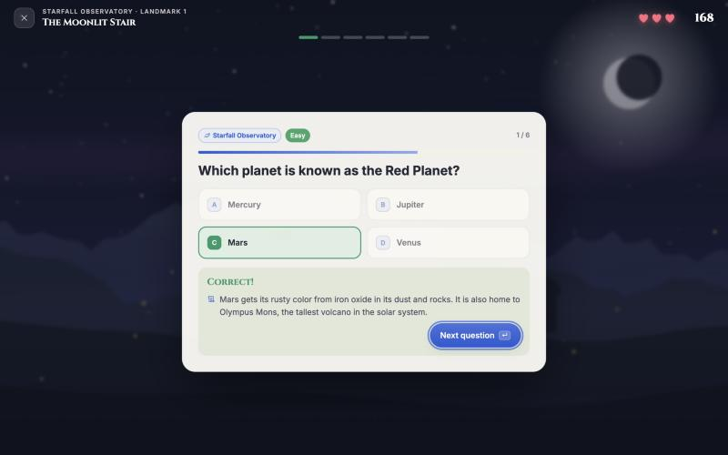
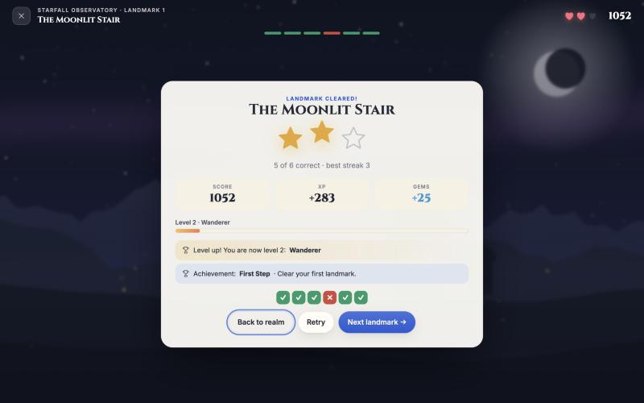
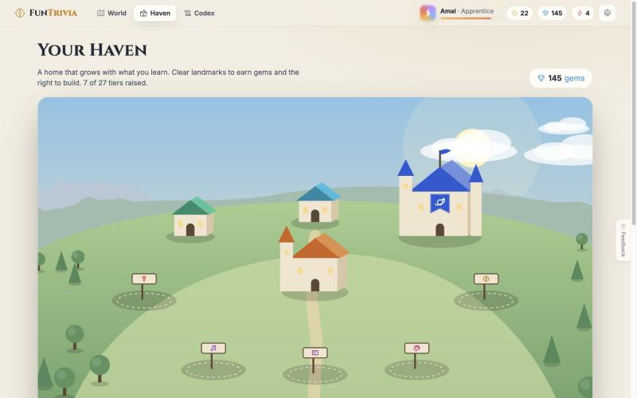
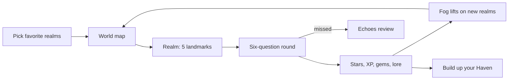

# FunTrivia

A trivia adventure for the browser and the Mac. You explore nine realms of knowledge on an illustrated map, clear landmarks, defeat each realm's guardian and build up your own Haven, learning a new fact with every question.

| A realm's trail of landmarks | A question, with the lore it teaches |
|---|---|
|  |  |
| **Rewards after every landmark** | **Your Haven grows as you learn** |
|  |  |
| **The Codex at night** | **The world map at night** |
|  |  |

**Mac app:**

**Play in the browser:** `npm start`, then open http://localhost:5173
**Build the Mac app:** `mac/build.sh` makes `build/FunTrivia.app` and `build/FunTrivia.dmg`

- [How to set up, run and play](docs/INSTRUCTIONS.md)
- [System design](docs/SYSTEM-DESIGN.md)
- [What's where](docs/FILE-STRUCTURE.md)
