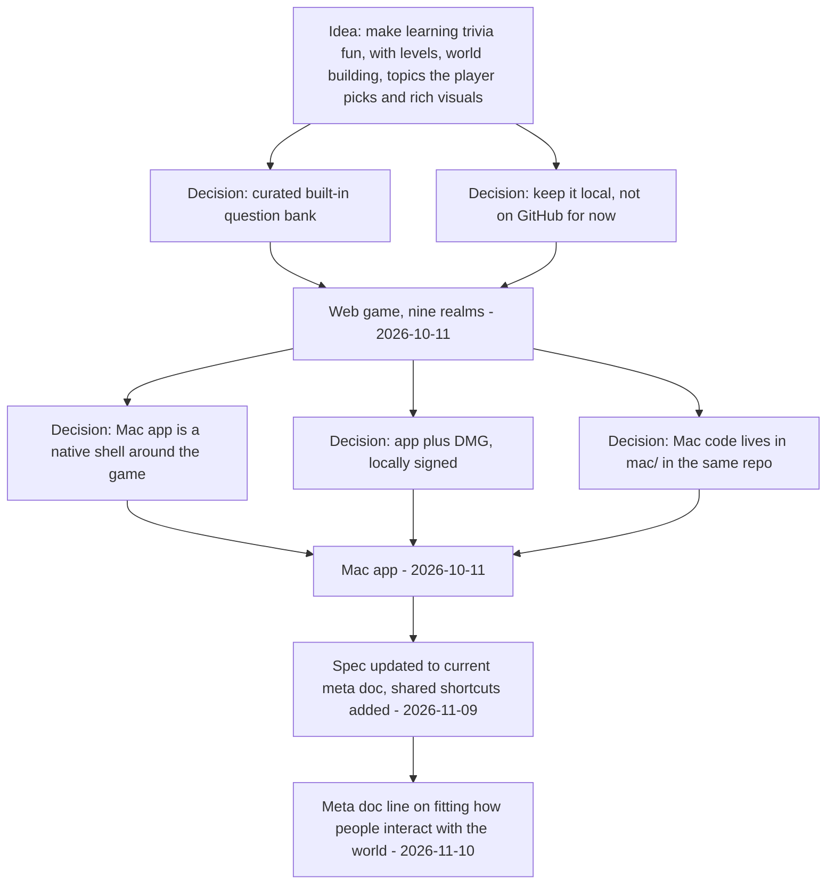
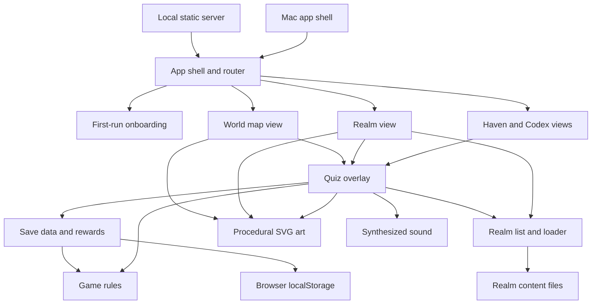
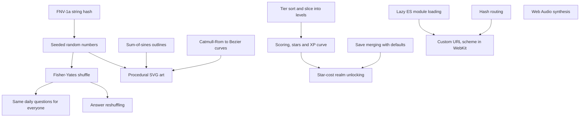

<!-- ProjectForge explainer at e6f4e3b -->
# How FunTrivia was built

FunTrivia is a trivia game that plays like an adventure. It is for anyone who wants to learn facts across nine topics, which the game calls "realms", without it feeling like a test. The idea that makes it work: every question belongs to a place on a map. Answering questions clears landmarks, lifts the fog off new realms and grows a home base, and every answer ends by teaching a fact.

## Build history

- **Web game, 2026-10-11.** The first commit, "a trivia adventure across nine realms of knowledge", adds the whole browser game. The questions come from a curated bank built into the code, as the author decided, so there is no question API or generator.
- **Mac app, 2026-10-11.** Adds the Mac app. As the author decided, it is a native window around the same game, kept in `mac/` in the same repo and packaged as an app plus a DMG with a local signature.
- **Spec and shortcuts, 2026-11-09.** Brings the project spec up to the current meta doc and adds the shared `Shortcuts.md`. The game code does not change.
- **Meta doc line, 2026-11-10.** Adds the meta doc's line on fitting how people naturally interact with the world. Again, a documentation change only.

## Code map

| Part | File | What it does |
|---|---|---|
| Local static server | `scripts/serve.js` | Serves the repo folder over HTTP on port 5173 (or `$PORT`), with no dependencies. `npm start` runs it. |
| Mac app shell | `mac/Sources/main.swift` | An AppKit window with a WebKit view that loads the bundled game through a private `funtrivia://` scheme, plus native menus, dialogs and a clipboard bridge. |
| Mac build | `mac/build.sh` | Compiles a universal binary with `swiftc`, copies in the game files, renders the icon, writes `Info.plist`, signs the app and makes the DMG. |
| App shell and router | `src/main.js` | Loads the save, applies theme, sound and motion settings, draws the top bar and picks a view from `location.hash`. |
| First-run onboarding | `src/ui/onboarding.js` | Asks for a name, up to 3 favorite realms and a pace, and stores them in `prefs`. |
| World map view | `src/ui/map.js` | Shows the nine realms, their unlock costs, and buttons for the Daily Expedition and Echoes. |
| Realm view | `src/ui/realm.js` | Shows one realm's panorama with its five landmarks, guide and progress, and opens a landmark's intro dialog. |
| Haven and Codex views | `src/ui/haven.js`, `src/ui/codex.js` | Haven spends gems on buildings. Codex lists the facts learned and starts Echoes review. |
| Quiz overlay | `src/ui/quiz.js` | Runs a round of up to six questions: hearts, timer, combo, fact reveal, and the results screen. |
| Game rules | `src/engine.js` | Pure functions with no page or storage access: level slicing, shuffling, scoring, stars, XP, unlocking, Haven costs, daily picks, achievements, streaks. |
| Save data and rewards | `src/state.js` | The save format, loading with defaults, saving, and `applyRound`, which turns a finished round into rewards. |
| Realm list and loader | `src/realms.js` | Names, topics, map positions and colors for the 9 realms in 3 regions. Loads each realm's content file on demand. |
| Realm content files | `data/realms/*.js` | Each realm's intro, guide, 5 landmarks with lore, and 30 questions, each with a fact. |
| Procedural SVG art | `src/art/*.js` | Builds the world map, realm panoramas, Haven and icons as SVG text in code. There are no image files. |
| Synthesized sound | `src/ui/sound.js` | Makes every sound effect from oscillators at play time. There are no audio files. |

## Concepts

**FNV-1a string hash** — A short way to turn a text string into a 32-bit number. It starts from a fixed number, then for each character XORs in the character code and multiplies by a fixed prime (16777619). The game needs it so that a text seed like `"daily:2026-11-19"` or `"scene:cosmos"` can start a random number generator. It lives in `hashString` in `src/engine.js`.

**Seeded random numbers** — A generator that gives the same sequence of "random" numbers every time it starts from the same seed. `seededRng` in `src/engine.js` uses the mulberry32 method: it adds a constant (`0x6d2b79f5`) to a 32-bit state, mixes the bits with shifts, XORs and multiplies, and divides by $2^{32}$ to get a number between 0 and 1. The game needs this for two things. Every player who has the same open realms gets the same daily questions. And every picture is the same on every visit, even though it is generated. It is used in `src/engine.js` (`dailyQuestions`), `src/art/map.js`, `src/art/scene.js` and `src/art/haven.js`.

**Fisher–Yates shuffle** — The standard fair shuffle. It walks the list from the end, and swaps each item with a random item at or before it. Every order is equally likely. `shuffle` in `src/engine.js` takes the random source as an argument, so the same function gives a fixed order with a seeded source and a fresh order with `Math.random`. `prepareQuestion` uses it to shuffle the answer positions, then updates `answer` to where the correct choice landed: `answer: order.indexOf(q.answer)`.

**Tier sort and slice into levels** — Each realm has 30 questions marked tier 1, 2 or 3 (easy, medium, hard), 10 of each. `levelQuestions` in `src/engine.js` sorts them by tier, keeping the file order within a tier, then cuts out 6 at a time. Landmark 1 gets questions 0–5 (all easy). Landmark 3 gets questions 12–17 (all medium). Landmark 5, the "guardian", gets questions 24–29 (all hard). Landmarks 2 and 4 mix two tiers, which is why the intro dialog in `src/ui/realm.js` labels them "Easy · Medium" and "Medium · Hard". Each landmark always asks the same six questions, so replaying a landmark is a chance to get better at it.

**Scoring, stars and XP curve** — `scoreAnswer` in `src/engine.js` scores one correct answer. A wrong answer scores 0.

$$\text{points} = \operatorname{round}\Big(\big(B_{\text{tier}} + \operatorname{round}(60 \cdot \operatorname{clamp}(t_{\text{left}}/t_{\text{limit}}, 0, 1)) + 25\cdot\min(c, 6)\big)\cdot m_{\text{pace}}\Big)$$

Here $B$ is 100, 150 or 200 by tier. $c$ is how many correct answers came in a row before this one. $m$ is 1, 1.2 or 1.5 for the Relaxed, Standard and Swift paces (`PACES`). Relaxed has no timer, so it gets no speed bonus. Stars come from hearts: a landmark round starts with 3, and each wrong answer costs one. `starsFor` gives 3 stars for 6 right, 2 for 5, 1 for 4, and 0 (not cleared) otherwise. Player level comes from total XP:

$$\text{xpToReach}(n) = 75\,(n-1)\,n + 100\,(n-1)$$

So level 2 needs 250 XP and level 3 needs 650. Each level costs 150 XP more than the one before. `levelFromXp` counts up until the next level is out of reach. `applyRound` in `src/state.js` awards `round(score / 4) + 10 × stars` XP.

**Star-cost realm unlocking** — This is how the player's choices shape the world. The favorite realms picked during onboarding start open. `unlockOrder` in `src/engine.js` lists the other realms in order. Realms in the same region as a favorite come first, then the rest. The k-th realm in the list opens at $6k$ total stars. `openRealmIds` in `src/state.js` also keeps any realm with saved progress open, so changing favorites later never locks a realm the player has already played. `src/art/map.js` draws fog over closed realms: seven blurred circles per realm, softened with an SVG `feGaussianBlur` filter.

**Save merging with defaults** — All progress is one JSON object in `localStorage` under `funtrivia.save.v1`. `load` in `src/state.js` spreads the saved object over `freshState()`, and does the same one level down for `prefs` and `stats`. A save written before a field existed therefore still gets that field's default. A corrupt save falls back to a fresh one, and a failed write (for example in private browsing) is ignored so play can continue.

**Sum-of-sines outlines** — Islands and hills are shapes whose edge wobbles smoothly. `blob` in `src/art/shapes.js` sets the radius at each angle $a$ to $1 + w\,(0.5\sin(2a+\phi_1) + 0.3\sin(5a+\phi_2) + 0.2\sin(9a+\phi_3))$ plus a little noise. The phases $\phi$ come from the seeded generator. `ridge` does the same thing along a horizontal line to make mountain silhouettes. Low frequencies give the overall shape and high ones add detail, which looks like natural coastline instead of a circle.

**Catmull-Rom to Bézier curves** — SVG draws smooth curves as cubic Béziers, which need two control points per segment. A Catmull-Rom spline is a smooth curve through a list of points. `smoothClosed` in `src/art/shapes.js` converts one to the other. For the segment from $p_1$ to $p_2$, the control points are $c_1 = p_1 + (p_2 - p_0)/6$ and $c_2 = p_2 - (p_3 - p_1)/6$. This turns the wobbly point lists from `blob` into smooth island outlines.

**Procedural SVG art** — Every picture is SVG markup built as a string at run time. `realmScene` in `src/art/scene.js` stacks a sky gradient, a sun or moon, clouds by day or an aurora by night, three ridges, a signature skyline for the realm, and a trail through the five landmark positions in `TRAIL`. Colors come from the realm's hue in `src/realms.js`. Each region uses one family of hues: blue-green for science, red to gold for history and other human-story topics, violet to pink for the arts. The art stays sharp at any size and needs no image downloads.

**Lazy ES module loading** — Each realm's content is a JavaScript module, not JSON. `loadRealm` in `src/realms.js` loads it with `import(\`../data/realms/${id}.js\`)` and caches the result merged with the realm's metadata. Because the files are plain modules, the website needs no build step and no fetch-and-parse code.

**Hash routing** — The part of the URL after `#` decides the view: `#/map`, `#/realm/<id>`, `#/haven`, `#/codex`. `route` in `src/main.js` splits the hash and calls the matching `render…` function, and a `hashchange` listener reruns it. Changing the hash never reloads the page, so this works from any static host and inside the Mac app.

**Custom URL scheme in WebKit** — WebKit blocks ES modules loaded from `file://` URLs. So the Mac app registers its own scheme, `funtrivia://`. `BundleSchemeHandler` in `mac/Sources/main.swift` answers each request by reading the file from `Contents/Resources/web` and sending it back with a MIME type. It refuses any path outside that folder. This gives the game a stable origin (`funtrivia://app`), so modules load and `localStorage` persists between launches. The web clipboard API doesn't work on this scheme, so "Copy all" in the feedback panel posts a `clipboard` message that the Swift side writes to the pasteboard.

**Web Audio synthesis** — Each sound is one or more oscillators with a short volume envelope. `tone` in `src/ui/sound.js` ramps the gain up in 15 ms and back down over the note. The "correct" chime rises a semitone for each answer in the current streak, up to 6: frequency $= 523 \cdot 2^{\min(c,6)/12}$ Hz. The rising pitch lets the player hear their streak growing.

## One input, start to finish

The input: a player on Standard pace clicks landmark 1, "The Moonlit Stair", in Starfall Observatory (`cosmos`), then answers the first question correctly with 20 seconds left.

1. **The click.** In `src/ui/realm.js`, `renderRealm` gave each landmark button a click handler. The handler calls `isLevelOpen(prog, 0)` from `src/engine.js`, which is always true for the first landmark. It plays `sfx.tap()` and calls `landmarkIntro`, which shows the landmark's lore in a dialog. The player clicks **Begin**, which calls `startLevel(app, realm, 0)` in `src/ui/quiz.js`.
2. **Picking questions.** `startLevel` calls `levelQuestions(realm, 0)` in `src/engine.js`. Tier sorting puts the ten tier-1 questions first, and slice 0 is `cosmos-01` to `cosmos-06` from `data/realms/cosmos.js`. Each one goes through `prepareQuestion`, which shuffles its four choices and fixes the `answer` index.
3. **Setting up the round.** `run` in `src/ui/quiz.js` reads the pace from `app.state.prefs.pace`. For Standard the limit is 25 seconds (`PACES` in `src/engine.js`). It sets 3 hearts, builds the overlay, and draws the realm's night panorama behind it with `realmScene`.
4. **Showing the question.** `show` renders "Which planet is known as the Red Planet?" and its four buttons, labeled A–D (keys 1–4 or A–D also work). It starts a 50 ms timer that shrinks the time bar and ticks in the last 3 seconds.
5. **Answering.** The player clicks "Mars" with 20 s left. `choose` sees that it matches `q.answer` and calls `scoreAnswer` with tier 1, 20 of 25 seconds left, combo 0 and Standard pace: $(100 + \operatorname{round}(60 \cdot 0.8) + 0) \cdot 1.2 = 148 \cdot 1.2 = 177.6$, which rounds to **178**. It records `{ id: "cosmos-01", realm: "cosmos", correct: true }`, raises the combo to 1, plays `sfx.correct(1)`, and shows the fact about iron oxide and Olympus Mons.
6. **Ending the round.** Say the player gets all six right. `finish` calls `starsFor(6, 6)`, which gives 3 stars. It then calls `applyRound(app.state, "level", …)` in `src/state.js`.
7. **Applying rewards.** `applyRound` runs `touchStreak` (via `nextStreak` in `src/engine.js`) and `recordAnswers`, which adds six Codex entries and removes any of these questions from Echoes. It sets `progress.cosmos[0]` to 3, which can only go up. It awards XP as `round(score / 4) + 30`. Since this is a first clear, it awards `gemsFor(3, { firstClear: true })` = 15 + 15 + 5 = **35 gems**. Its inner `finish` compares levels before and after, finds newly opened realms with `openRealmIds`, and tests every `ACHIEVEMENTS` rule. "First Step" and "Flawless" both pass here.
8. **Saving and showing.** Back in `src/ui/quiz.js`, `app.save()` calls `save` in `src/state.js`, which writes the JSON to `localStorage["funtrivia.save.v1"]`. `app.refreshHud()` in `src/main.js` updates the top bar. The results card counts up score, XP and gems, lists any level-up, unveiled realm or achievement, and plays the fanfare and confetti for a 3-star clear. **Next landmark →** calls `startLevel(app, realm, 1)`, and `isLevelOpen` now lets landmark 2 open.

## Where this came from

Written from the spec, the author's decisions, the git history and the code as of commit e6f4e3b (2026-11-10).
