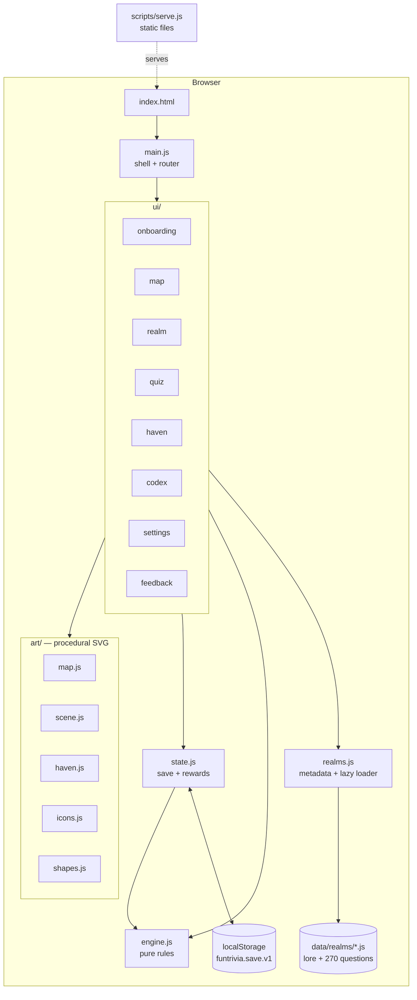

# FunTrivia System Design

FunTrivia is a static, client-only web game. The browser loads plain ES modules, draws every picture as procedural SVG, and saves progress in `localStorage`. There is no backend, no build step and no dependencies.

## Architecture

## Components

| Component | Job |
|---|---|
| `engine.js` | Pure game rules with no DOM or storage: slicing a realm into 5 levels, shuffling answers, scoring, stars, the XP curve and titles, which realms and levels are open, Haven costs, daily question choice, achievements, streaks. |
| `state.js` | The save format, loading it with defaults (so old saves keep working), saving it, and `applyRound`, which turns a finished round into stars, gems, XP, Codex entries, Echoes, newly unveiled realms and achievements. |
| `realms.js` | Static metadata for the 9 realms and 3 regions (names, topics, map coordinates, theme colors). It also lazy-loads each realm's content module. |
| `data/realms/*.js` | The content for each realm: intro, guide character, 5 landmarks with lore, and 30 questions (10 per tier), each with a teaching fact. |
| `art/*` | Procedural SVG artists. Each one takes state in and returns an SVG string. Seeded randomness keeps every picture the same on every visit. |
| `ui/*` | One module per view or dialog. Each renders HTML into the view container and wires up events. |
| `main.js` | Boots the app, applies settings (theme, motion, sound), draws the top bar, routes on `location.hash`, and handles ⌘,. |
| `scripts/serve.js` | A tiny static server for local play. In production, any static host works. |

## Main flows

**First run.** `main.js` sees `onboarded: false` and runs onboarding: name, then up to 3 favorite realms, then pace. The choices are saved to `prefs`, and the world map renders with only the favorites unveiled.

**Playing a landmark.**
1. The realm view opens a landmark intro dialog.
2. `quiz.startLevel` takes six questions from `engine.levelQuestions` and shuffles each one's choices.
3. The quiz overlay tracks hearts, combo, timer and score.
4. After every answer it shows the question's fact.
5. When the round ends, `state.applyRound("level", …)` updates progress (stars only ever go up), the Codex and Echoes, XP and gems. It also works out which realms just unveiled and which achievements were just earned.
6. The results screen animates these and offers Retry or Next landmark.

**Unveiling realms.** `engine.unlockOrder(favorites)` lists the locked realms, nearest first: realms in a favorite's region come before the rest. Each costs 6 more total stars than the one before. Any realm with progress stays open even if favorites change later.

**Daily Expedition.** `engine.dailyQuestions` seeds a random number generator with the date, so everyone with the same open realms gets the same six questions that day. Gems are paid once per day.

**Echoes.** A wrong answer adds the question to `echoes`. A later correct answer, in any mode, removes it. The Echoes round replays up to six of them.

**Haven.** `engine.canBuild` checks the realm's cleared landmarks (1, 3, 5) and gem cost (30, 70, 140) for each tier. `state.build` spends the gems and raises the tier.

## Where data lives

| Data | Location | Notes |
|---|---|---|
| Questions, lore, guides | `data/realms/*.js` (shipped with the site) | Static and hand-checked. ES modules, so no fetch or JSON parsing. |
| Player progress | `localStorage["funtrivia.save.v1"]` | One JSON object; its shape is in `state.freshState()`. |
| Feedback notes | Inside the same save (`feedback[]`) | Kept when progress is reset. Copied out by the user. |

## Key decisions and trade-offs

- **A curated question bank instead of an API or AI generation.** It works offline, costs nothing to run and needs no API key, and the facts were checked when written. The trade-off is a fixed set: 270 questions across 9 topics. Adding more means editing data files.
- **No build step or framework.** Anyone can read, run and host it with nothing but Node or any static server. The trade-off is hand-written DOM code and no bundling, though modules load in parallel and are small.
- **Procedural SVG art instead of image files.** It is crisp at any size, themable through CSS variables (day and night), adds no download weight, and makes each realm look distinct. The trade-off is that the art is stylized (flat, layered poster style) rather than painted.
- **Colors follow similarity.** Each region is one hue family: science is teal to blue, the human story is red to gold, and the arts are violet to pink. Realms within a region sit far enough apart in hue to tell at a glance, and each has its own light and dark shade.
- **Fixed questions per landmark.** Questions are sorted by tier and sliced, so each landmark always teaches the same six facts and replays are about mastery. Answer order is reshuffled every time.
- **Progress lives only in `localStorage`.** It is private and needs no accounts, but progress doesn't follow you to another browser or device.
- **Feedback is stored locally.** No data leaves the browser. The user copies notes out by hand.

## How it's tested

- `npm test` runs Node's built-in test runner, with 27 tests:
  - **engine:** level slicing, answers staying correct after shuffling, scoring order, stars, the XP curve, unlock order, level gating, build rules, the daily seed, streaks.
  - **state:** save round-trip and recovery from corrupt data, rewards, stars never dropping, Echoes clearing, realm unveiling, the once-a-day gem payout, building.
  - **content:** every realm has 5 landmarks and 30 questions split 10/10/10, unique ids, 4 distinct choices, a valid answer index and a fact, and no question appears twice anywhere.
- Manual check in a browser:
  - onboarding
  - map in day and night themes
  - realm view
  - a full landmark round through results, level-up and achievements
  - Daily Expedition and Echoes
  - Haven building at every tier
  - Codex
  - Settings via ⌘,
  - phone width (375px, with no page-level sideways scrolling)

## Known limits

- Each realm has 30 questions, so a dedicated player will see them all. There is no way yet to add more without editing files.
- Progress is tied to one browser profile, with no export/import or cloud sync.
- The display fonts come from Google Fonts, so offline play uses fallback fonts.
- Chrome may keep ⌘, for itself in some setups. The gear button always opens Settings.
- On phones, the map and realm panoramas pan sideways instead of shrinking, so landmarks stay tappable.
- Sounds are synthesized blips. There is no music.
